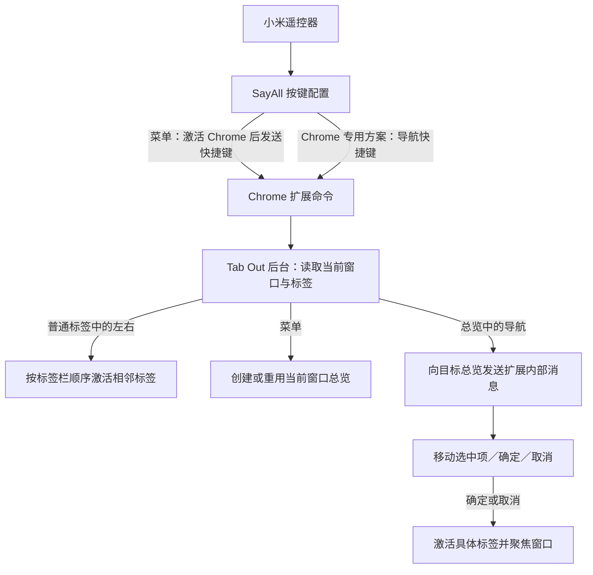

# 遥控器操作 Chrome 标签：SayAll × Tab Out

状态：用户已确认方案并要求下一步；已完成本地实现与自动验证，实机验收待进行。日期：2026-10-13。

## 目标与边界

第一版针对 macOS + Chrome，以小米蓝牙遥控器 2 / 2 Pro 验收。同一只遥控器提供当前窗口的快速标签切换，以及跨窗口的标签总览选择。

SayAll 只做按键配置，使用其按 App 自动方案能力；用户已接受该功能属于私有付费模块的依赖。Tab Out 负责扩展改造，两者用快捷键协作。代码仓库阅读不代表目标安装包已经具备完整功能，也不代表实机输入链路已经验证。

## 操作约定

| 按键 | 普通 Chrome 标签前台 | Tab Out 总览前台 | 其他 App 前台 |
|---|---|---|---|
| 菜单 | 呼出当前窗口的总览 | 刷新总览，保留选择 | 激活 Chrome，再呼出总览 |
| 左／右 | 当前窗口上一／下一标签，首尾循环 | 按屏幕方向移动选中位置，边界停止 | 不执行浏览器导航 |
| 上／下 | 本功能不执行动作 | 按屏幕方向移动选中位置，边界停止 | 不执行浏览器导航 |
| 确定 | 本功能不执行动作 | 激活选中标签，并聚焦对应窗口 | 不执行浏览器导航 |
| 返回 | 本功能不执行动作 | 取消选择，回到来源标签 | 不执行浏览器导航 |
| 语音键 | 沿用 SayAll 语音输入 | 沿用 SayAll 语音输入 | 沿用 SayAll 语音输入 |

左右采用快速点按，每按一次移动一个目标，不要求按住连续切标签。本功能不占用音量、主页等其他按键。

## 总览约定

- 保留 Tab Out 的网站分组。遥控模式自动展开分组，超过八个标签也能直接选中；鼠标模式保留原有体验。
- 同网址的每个真实标签独立显示，并标注所在窗口。选择与激活均以具体标签身份为准。
- 首次呼出选中来源标签；已经在总览时再次按菜单，保留当前选择。选中项已消失时选择邻近可用项，并明确更新状态。
- 四个方向按屏幕上邻近标签的位置移动，自动滚动让选中项可见。方向选择只经过标签目标，保存、关闭等按钮不进入这条选择路径。
- 每个 Chrome 窗口最多重用一个由遥控呼出功能管理的总览。用户自行打开的新标签页无需被自动关闭。
- 快速切换跳过 Tab Out 总览自身。只有一个有效目标时留在该标签；没有有效目标时不执行切换。
- 返回到呼出前的 Chrome 来源标签，不恢复其他 App。来源标签已关闭时保留总览并提示原标签不可用。
- 标签被创建、关闭、移动或改名后刷新总览；保持有效的选中标签身份，不因重新渲染跳到另一个同网址标签。

## 输入与标签处理

菜单、四个方向、确定、返回均进入 Chrome 扩展命令，不依赖地址栏是否把键盘焦点交给网页。普通标签只处理左右快速切换；总览将同样的左右命令解释为选择移动。

后台与总览页面使用 `runtime` 消息或端口，并带目标窗口／总览实例身份。不能把广播消息交给所有已打开的总览同时执行。新总览准备好之前，需要保留本次来源标签及初始选择。

导航命令按窗口顺序处理，避免快速连续点按时两个命令读取同一旧标签而丢掉一步。总览状态应能够在 Manifest V3 service worker 恢复后重新读取，不能依赖后台永不退出。

## 建议快捷键与首次配置

以下绑定已在隔离 Chromium 中验证；日常 Chrome 中是否被占用仍需首次配置检查。Mac 的 `Alt` 对应 Option。

| 扩展命令 | 遥控器键 | 候选快捷键 | 首次绑定 |
|---|---|---|---|
| `show-dashboard` | 菜单 | Command + Shift + Y | 默认建议 |
| `navigate-left` | 左 | Option + Shift + L | 默认建议 |
| `navigate-right` | 右 | Option + Shift + R | 默认建议 |
| `confirm-selection` | 确定 | Option + Shift + E | 默认建议 |
| `navigate-up` | 上 | Option + Shift + U | 手动补充 |
| `navigate-down` | 下 | Option + Shift + D | 手动补充 |
| `cancel-selection` | 返回 | Option + Shift + B | 手动补充 |

Chrome 最多允许四个命令带默认建议快捷键；另外三个通过扩展快捷键设置补充。系统、Chrome 或其他扩展占用候选组合时，需要换一个可注册的组合，并同步 SayAll 映射。扩展应展示未绑定命令，便于配置和验收。

SayAll 配置步骤：

1. 默认方案中，菜单单击使用“打开自定义 App”：选 Chrome，并配置激活后的总览快捷键。单纯选择预设“打开 Chrome”不包含后续快捷键。
2. 默认方案中，本功能使用的方向、确定和返回键设为不执行。
3. 开启按 App 自动匹配，为 Google Chrome 配置专用方案，按上表覆盖六个导航键；菜单继承默认动作。
4. 左右开启“连续快速按”，清除双击和长按附加动作。其他导航键也不增加手势分支，以保持一次按键对应一次操作。
5. Chrome 的导航命令保持浏览器范围生效；菜单从其他 App 呼出的能力由 SayAll 激活 Chrome 后发送命令实现。

## 改动范围

| Tab Out 文件 | 改动责任 |
|---|---|
| `extension/manifest.json` | 声明七个命令与四个默认建议绑定 |
| `extension/background.js` | 命令分派、当前窗口快速切换、总览重用、来源标签与消息路由 |
| `extension/app.js` | 遥控模式、真实标签独立展示、选中状态、方向移动、确认与取消、标签变化同步 |
| `extension/style.css` | 醒目的选中框、选中项可见性与布局变化支持 |
| `extension/index.html` | 遥控操作提示与必要的配置状态展示 |

本地实现将后台遥控处理拆入 `remote-background.js`，总览控制拆入 `remote-dashboard.js`，空间移动拆入 `spatial-navigation.js`，保持上述责任边界。SayAll 仓库不改代码，交付配置说明。

## 验收场景

| 场景 | 预期结果 |
|---|---|
| 其他 App 前台按菜单 | Chrome 成为前台并进入总览；无需再用鼠标聚焦 |
| 普通网页的输入框或地址栏获得焦点 | 左右遥控键仍按定义切标签，不编辑输入内容 |
| 当前窗口 A、B、C 三个标签 | 右按 A→B→C→A；左按反向循环；总览自身被跳过 |
| 两个窗口打开同一网址 | 总览显示两个独立目标，确定后进入准确的标签与窗口 |
| 某网站有十二个标签 | 遥控模式可选到第十二个标签，不依赖鼠标点击更多 |
| 按菜单后移动选择，再按菜单 | 重用总览，不增加新的遥控总览；有效选中项保持 |
| 总览返回 | 回到来源标签；来源已关闭时给出可理解的状态 |
| 连续快速点按左右 | 每次有效按键都对应一步切换，没有竞态丢步 |
| 选择期间目标被关闭或移动 | 更新列表；不会按网址误切到别的标签 |
| 后台 service worker 被终止后再次按键 | 可恢复来源与总览状态并继续操作 |
| Chrome 以外的 App 前台按方向 | 不执行本功能的导航快捷键 |

自动测试已覆盖标签身份、顺序循环、快速命令串行、总览复用与状态恢复，并在隔离 Chromium 中检查真实扩展加载和界面导航。SayAll 激活后快捷键发送、按 App 方案切换、权限和小米遥控器输入仍需实机验收。详细结果见 [实现与验证报告](implementation-report.md)。

## 证据与决策记录

- [仓库事实与限制](repository-findings.md)
- [领域术语](CONTEXT.md)
- [访谈记录](design-interview.md)
- [ADR：快捷键协作](docs/adr/0001-shortcut-integration.md)
- [ADR：所有导航使用扩展命令](docs/adr/0002-browser-commands-for-all-controls.md)
- [Chrome Commands API](https://developer.chrome.com/docs/extensions/reference/api/commands)
- [Chrome 新标签焦点规范](https://developer.chrome.com/docs/extensions/develop/ui/override-chrome-pages#best-practices)
